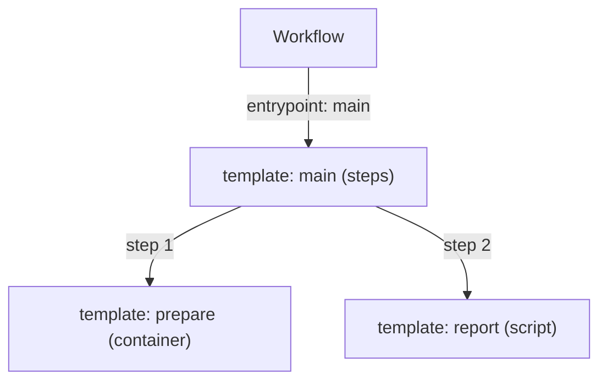

# Workflow Resources And Templates

Argo Workflows runs jobs on Kubernetes. A job can be one container, a list of steps or a graph of tasks that depend on each other. Argo Workflows describes each job as a Kubernetes object, so the same tools that manage other objects (`kubectl`, RBAC, GitOps) manage workflows too. This part explains the objects you write and the words the exam uses for them.

## Custom resources that Argo Workflows adds

Kubernetes lets a project add new object kinds with a CustomResourceDefinition (CRD). A CRD tells the Kubernetes API server a new kind exists, for example `Workflow`. Argo Workflows installs several CRDs in the API group `argoproj.io`:

- `Workflow` is one run. It holds the templates to run, the arguments, and later the status of the run.
- `WorkflowTemplate` is a reusable definition in one namespace. It does not run by itself.
- `ClusterWorkflowTemplate` is the same idea, but it is cluster scoped, so any namespace can use it.
- `CronWorkflow` creates a new `Workflow` on a schedule.
- `WorkflowTaskResult` is a small object that the executor in a pod writes so the controller can read the outputs of a task.

The API server stores these objects in etcd like any other object. A separate program, the workflow controller, reads them and does the work. Creating a `Workflow` object does nothing until that controller is running.

## The smallest useful Workflow

Read this Workflow before the rule behind it. It runs one container that prints a message:

```yaml
apiVersion: argoproj.io/v1alpha1
kind: Workflow
metadata:
  generateName: hello-
  namespace: starfleet
spec:
  entrypoint: say
  templates:
  - name: say
    container:
      image: docker.io/library/python:3.13-alpine
      command: [python, -c]
      args: ["print('hello from the probe task')"]
```

The `metadata.generateName` field asks the API server to add a random suffix, so every submission gets a new name such as `hello-x7k2p`. The `spec.entrypoint` field names the template where execution starts. The `spec.templates` list holds the template definitions. This example has one template, called `say`, and that template runs a container.

## Templates are the units of work

A template is a named definition of work. Argo Workflows groups templates in two families.

Work templates do something directly:

- `container` runs a container image with a command.
- `script` runs a source snippet inside an image. Argo saves the source to a file and runs it.
- `resource` creates, patches or deletes a Kubernetes object, then can wait for a condition on it.
- `suspend` pauses the workflow until a person resumes it or a duration ends.
- `containerSet` runs several containers in one pod.

Orchestration templates run other templates:

- `steps` runs lists of templates in order. Steps in the same inner list run in parallel.
- `dag` runs tasks, and each task lists which other tasks must finish first.

Every template has a `name`. A workflow can hold many templates, and one of them is the entrypoint. The other templates run only when another template calls them by name through the `template` field.



The diagram shows that the entrypoint is an ordinary template, and that it calls two other templates by name.

## Definition and execution are different things

A `Workflow` object mixes two roles. Its `spec` is a definition: templates, entrypoint, arguments. Its `status` is a record of one execution: phase, start time, node results. The controller writes `status` after the object is created. A learner never writes `status`.

A `WorkflowTemplate` holds only the definition role. A `Workflow` can point to it with `spec.workflowTemplateRef.name`. Then the run uses the stored templates, and the `Workflow` carries only the arguments and its own `status`.

This split has a practical consequence. Editing a `WorkflowTemplate` changes future runs. It does not change runs that already finished, and the `status` of a finished run keeps the node results of that run. Keep the template version and the arguments you used when a result must be explained later.

## Arguments, parameters and the template language

A parameter is a named string value. A workflow passes parameters in through `spec.arguments.parameters`. A template declares what it needs in `inputs.parameters`. A template refers to a value with a double brace expression such as `{{inputs.parameters.message}}` or `{{workflow.parameters.message}}`. The controller replaces the expression with the value before it creates the pod.

Because the controller does the replacement, the expression must be valid when the workflow is submitted. A wrong name such as `{{inputs.parameter.message}}` makes the workflow fail with an error that names the unresolved tag. The pod never starts.

Parameters are strings. A number is passed as text, and the container code must convert it. Large data does not belong in parameters, because parameters are stored in the `Workflow` object and the object size is limited by etcd. Artifacts carry larger data.

## Who may create a Workflow

Creating a `Workflow` is a normal Kubernetes create request, so RBAC decides who can do it. A user needs `create` on `workflows` in the group `argoproj.io`. The `serviceAccountName` field in `spec` selects the ServiceAccount that the workflow pods use. The pods, not the user, use that identity when they call the Kubernetes API. The next part shows what the pods need.

## What you now know

A `Workflow` is a Kubernetes object with a definition part and a status part. Templates are the units of work, and one template is the entrypoint. Reusable definitions live in `WorkflowTemplate` objects. Parameters carry small string values into templates. The open question is who turns this object into running containers, and what each component owns. The next part answers it.

## Common pitfalls

> [!WARNING]
> Do not treat the `Workflow` object as a run record only. Its `spec` is the definition and its `status` is the record. Do not put large or secret data in parameters, because anyone who can read the object can read the parameters.
