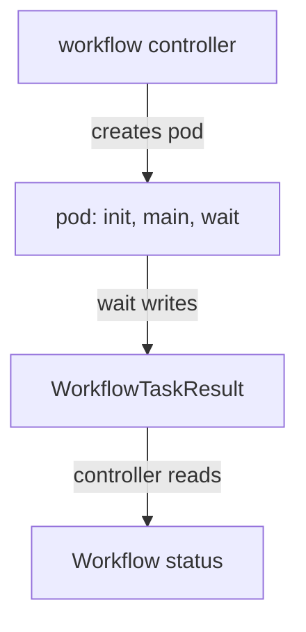

# Controller, Pods And Executor

A `Workflow` object is only a description. Several components turn it into running containers and record what happened. If you cannot say which component does which job, you cannot debug a stuck workflow. This part follows one workflow from creation to its final status and names the component responsible at each step.

## The workflow controller

The workflow controller is a Deployment, normally in the `argo` namespace. It uses a Kubernetes watch to see every `Workflow` object it is configured to manage. For each workflow it runs a loop, called a reconcile loop:

1. Read the `Workflow` and its `status`.
2. Decide which nodes (units of execution) can start now.
3. Create a pod for each node that is ready.
4. Read the pods and the task results, and write the new `status` back to the `Workflow`.

The controller does not run your application code. It only creates pods and updates status. If the controller is down, existing pods keep running, but no new nodes start and the `status` does not move until the controller returns.

## One pod per node

A node is one unit in the execution graph. A node has a type, for example `Pod`, `Steps` or `DAG`. Only a node of type `Pod` runs containers. The `Steps` and `DAG` nodes are bookkeeping nodes that group other nodes.

The controller creates the pod for a `container` or `script` node in the namespace of the `Workflow`. The pod name starts with the workflow name. The pod carries labels such as `workflows.argoproj.io/workflow`, so `kubectl get pods -l workflows.argoproj.io/workflow=<name>` lists the pods of one run.

Inside that pod there are usually three containers:

- `init` copies input artifacts and prepares the work area.
- `main` runs your image and command.
- `wait` is the executor sidecar. It watches `main`, collects outputs, saves artifacts and reports the result.

The executor is the program `argoexec`. The controller starts it from an image that you can pin with the `--executor-image` argument. The `init` and `wait` containers use that image, so the executor version and the controller version should match.

## How outputs reach the controller

The `wait` container reads the files you declared under `outputs`, for example the file behind an output parameter. It then creates a `WorkflowTaskResult` object in the cluster. The controller reads that object and copies the values into `status.nodes[*].outputs`. This is why a ServiceAccount used by workflow pods needs the `create` and `patch` verbs on `workflowtaskresults`. Without that permission, `main` can finish with exit code 0 while the node still fails, because the executor cannot report the result.



The diagram shows that the controller never talks to the container directly. The result goes through a Kubernetes object.

## Reading the status

`status.phase` is the state of the whole workflow. The values are `Pending`, `Running`, `Succeeded`, `Failed` and `Error`. `Failed` means a node ran and failed. `Error` means the controller hit a problem outside your code, for example an invalid template.

`status.nodes` is a map. Each entry holds fields such as `displayName`, `type`, `phase`, `templateName`, `startedAt`, `finishedAt`, `message` and, when present, `outputs`. The `phase` of a node uses `Pending`, `Running`, `Succeeded`, `Failed`, `Skipped`, `Error` and `Omitted`. A node is `Skipped` when a condition kept it from running, and `Omitted` when a dependency made it unreachable.

A node in `Pending` may wait for several reasons: the pod is not scheduled, the image is still pulling, or the workflow is limited by `parallelism`. The `message` field of the node usually names the reason, for example `ImagePullBackOff` for an image that cannot be pulled. Read the pod events with `kubectl describe pod` when the message is short.

## Failure examples with the responsible component

- The image name has a typo. The pod stays `Pending` or shows `ErrImagePull`. The node stays `Pending` and the workflow stays `Running` until `activeDeadlineSeconds` ends it. The kubelet cannot pull the image, so the fault is in the pod, not in the controller.
- `main` exits with a non-zero code. The node phase becomes `Failed` and the workflow becomes `Failed`. The application code is the cause.
- The output file path is wrong. `main` succeeds, but the executor cannot find the file, so the node fails with an output error. The template is the cause.
- The ServiceAccount lacks the `workflowtaskresults` permission. The node fails at the end, and the `wait` container log names the forbidden request. RBAC is the cause.

## Find the components on a live cluster

The playground for this module has the controller installed in the `argo` namespace. The commands below only read objects. Select the private cluster first, so you cannot change another cluster by mistake.

<!-- astrona:playground:renew -->

```sh
export KUBECONFIG="$(astrona kubeconfig ats-060-playground-010-01)"
test "$(kubectl config current-context)" = "kind-astro-ats-060-playground-010-01" || exit 1
```

List the custom resource definitions that belong to Argo Workflows:

```sh
kubectl get crd | grep argoproj.io
```

The list includes the kinds from the first part, for example `workflows.argoproj.io` and `workflowtemplates.argoproj.io`. Now check that the controller is running and read its arguments, where the executor image is set:

```sh
kubectl -n argo get deployment workflow-controller
kubectl -n argo get deployment workflow-controller -o jsonpath='{.spec.template.spec.containers[0].args}'
```

The second command prints the argument list of the controller container. In this playground it names the pinned executor image, so the `init` and `wait` containers use the same Argo version as the controller. Finally, check that the permission for task results exists for the workflow ServiceAccount:

```sh
kubectl -n starfleet auth can-i create workflowtaskresults.argoproj.io --as=system:serviceaccount:starfleet:workflow-runner
```

The command prints `yes` or `no`. A `no` here explains a node that fails at the end of a run even when the container exits with code 0.

## What success proves

A `Succeeded` phase means every node reached a terminal state that the template accepts. It does not prove that an external database holds the right rows. A task that must change an external system needs its own check, and a retried task needs an idempotent design, because a retry runs the work again.

## What you now know

The controller turns a `Workflow` into pods, one pod per work node. The `wait` sidecar reports outputs through a `WorkflowTaskResult`, and the controller records them in `status`. The phase of a workflow and the phase of each node tell you where a run stopped. The open question is how to read all this on a live cluster, which the task and the practice session on the next pages do.

## Common pitfalls

> [!WARNING]
> A pod in `Pending` is a Kubernetes scheduling or image problem, not an Argo problem. Check the pod events before you change the workflow. A missing `workflowtaskresults` permission fails a node even when your code exits with code 0.
