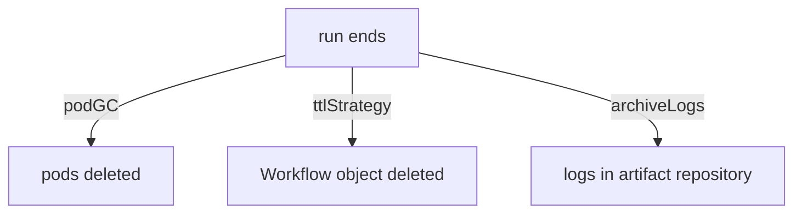

# Observing Results And Cleaning Up

A finished workflow leaves objects behind: the `Workflow` itself, the pods of every node, and any stored artifacts. Left alone, they fill the cluster. Removed too early, they take the evidence of the run with them. This part explains where the results of a run live, and which fields control how long they stay.

## Where the result of a run is stored

A run produces information in four places, and each place has its own lifetime.

- The `Workflow` object holds `status.phase`, the node tree and the output parameters. It lives until someone deletes it, or until a TTL (time to live) setting deletes it.
- The pods hold the container logs. The kubelet keeps the logs while the pod exists, so deleting a pod deletes its logs from the cluster.
- The artifact repository holds saved files. Its lifetime is set by the repository, not by the cluster objects.
- The workflow archive, when it is configured, holds finished `Workflow` objects in a SQL database, so they can be shown after the object is deleted. The archive needs a database and the Argo Server.

Because the lifetimes differ, one cleanup setting cannot remove everything. A run can have no pods and still have artifacts, or have a `Workflow` object and no logs.

## Read status and logs

`kubectl get workflow <name>` shows the phase, the age and sometimes a message. For detail, read the object as YAML and look at `status.nodes`. Each node carries the phase and, for failed nodes, a `message` such as `Error (exit code 1)`.

Logs come from the pods. `kubectl logs <pod> -c main` prints the output of your container. `kubectl logs <pod> -c wait` prints the executor log, which shows output collection problems and permission errors. `argo logs <workflow>` collects the `main` logs of all pods of a run so you do not look up pod names.

## Time to live for the Workflow object

The `spec.ttlStrategy` field tells the controller when to delete the `Workflow` object after it ends. It has three fields, all in seconds:

- `secondsAfterCompletion` applies to a run that succeeded or failed.
- `secondsAfterSuccess` applies only to a run that succeeded.
- `secondsAfterFailure` applies only to a run that failed.

A short time for success and a long time for failure is a common setup: successful runs disappear quickly, and failed runs stay long enough for someone to investigate them. Deleting the `Workflow` object also deletes its pods, because the pods are owned by the workflow through an owner reference.

## Pod garbage collection

The `spec.podGC` field removes pods while the workflow object remains. The `strategy` field selects when:

- `OnPodCompletion` deletes each pod as soon as it finishes, whether it succeeded or failed.
- `OnPodSuccess` deletes a pod only if it succeeded, so failed pods stay for debugging.
- `OnWorkflowCompletion` deletes all pods when the workflow ends.
- `OnWorkflowSuccess` deletes all pods only when the workflow succeeded.

The `status` of the workflow still lists the nodes after the pods are gone, but `kubectl logs` can no longer read their logs. If you need the logs later, save them as artifacts with `archiveLogs: true` in the workflow or in the controller configuration. The logs then go to the artifact repository.



The diagram shows three independent cleanup settings that all start when the run ends.

## Identity and retention

`spec.serviceAccountName` selects the ServiceAccount of the workflow pods. If the field is empty, the pods use the `default` ServiceAccount of the namespace, which usually has no permission to create task results, so nodes fail at the end. A narrow ServiceAccount is better than a broad one: a task that only transforms a file needs the task result permission and nothing else.

Deleting a `Workflow` manually with `kubectl delete workflow <name>` removes the object and its pods. It does not remove stored artifacts unless artifact garbage collection is configured for them.

## A worked reasoning example

A team wants successful runs removed after one hour, failed runs kept for a day, and pod logs kept for failed runs only. The fields that match are `ttlStrategy.secondsAfterSuccess: 3600`, `ttlStrategy.secondsAfterFailure: 86400` and `podGC.strategy: OnPodSuccess`. With `OnPodSuccess`, failed pods stay and keep their logs until the TTL deletes the whole workflow after a day.

## Try pod garbage collection

Start the module playground and select its private cluster. The commands change only this cluster.

<!-- astrona:playground:renew -->

```sh
export KUBECONFIG="$(astrona kubeconfig ats-060-playground-010-02)"
test "$(kubectl config current-context)" = "kind-astro-ats-060-playground-010-02" || exit 1
```

Save this as `workflow-gc-demo.yaml`. It runs one container and asks the controller to delete each pod when it completes:

```yaml
apiVersion: argoproj.io/v1alpha1
kind: Workflow
metadata:
  name: gc-demo
  namespace: starfleet
spec:
  serviceAccountName: workflow-runner
  entrypoint: write
  podGC:
    strategy: OnPodCompletion
  templates:
  - name: write
    container:
      image: docker.io/library/python:3.13-alpine
      command: [python, -c]
      args: ["print('done')"]
```

Create it:

```sh
kubectl create -f workflow-gc-demo.yaml
```

Then check the result. Wait until the phase is `Succeeded`, then list the pods of the run:

```sh
kubectl -n starfleet wait --for=jsonpath='{.status.phase}'=Succeeded workflow/gc-demo --timeout=240s
kubectl -n starfleet get pods -l workflows.argoproj.io/workflow=gc-demo
```

The `Workflow` object remains and its status still lists the node. The pod list is empty or the pod is shutting down, because the controller deletes the pod when it completes. A log request for that pod now fails, which is the cost of this strategy.

## What you now know

You know where the result of a run is stored and that each place has its own lifetime. You can pick `ttlStrategy` and `podGC` values for a stated retention need and you know that `archiveLogs` keeps logs after pods are gone. The practice session on the next pages applies these fields in the playground.

## Common pitfalls

> [!WARNING]
> Deleting pods deletes their logs. A TTL that is too short removes the `Workflow` object that you wanted to inspect. Artifacts stay in the repository after the workflow is deleted unless a separate garbage collection rule removes them.
