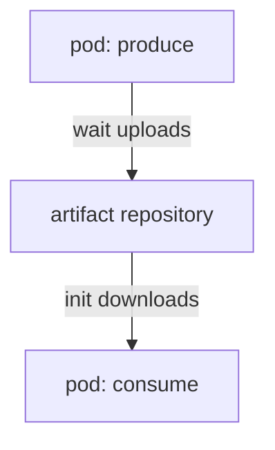

# Artifacts Compared With Parameters

A task often produces a file: a report, an image, a dataset. A parameter cannot carry that file, because a parameter is a short string stored inside the `Workflow` object. Argo Workflows solves this with artifacts. An artifact is a file or a directory that a task produces or consumes, and that Argo stores outside the pod in an artifact repository. This part explains what an artifact is, how it travels between tasks, and how it differs from a parameter.

## Parameters and artifacts are different channels

A parameter is a string. The controller keeps it in `status.nodes[*].outputs.parameters`, so it lives in etcd with the rest of the object. It is right for a small value such as an identifier, a count or a file name. The Kubernetes API limits the size of an object, so a large parameter makes the workflow fail or slow the cluster down.

An artifact is a file. Its data never enters the `Workflow` object. The object stores only a reference to it: the repository type, the bucket and the key. The data itself lives in the repository, for example an S3-compatible object store such as MinIO.

Use a parameter to steer a decision, such as which branch to run. Use an artifact to move data, such as a prepared dataset.

## Declare an output artifact

A template declares the files it produces under `outputs.artifacts`. Each entry needs a `name` and a `path`, which is the location inside the container:

```yaml
templates:
- name: produce
  container:
    image: docker.io/library/python:3.13-alpine
    command: [python, -c]
    args: ["open('/tmp/payload','w').write('roster')"]
  outputs:
    artifacts:
    - name: payload
      path: /tmp/payload
```

When the `main` container ends, the `wait` container of the pod reads `/tmp/payload`, packs it, and uploads it to the repository. The upload happens in the executor, not in your code. Your container only writes a file.

If the file is missing, the executor cannot upload it and the node fails with an error that names the path. The `optional: true` field on the output tells the executor to accept a missing file and continue.

## Declare an input artifact

A template that needs a file declares it under `inputs.artifacts`, again with a `name` and a `path`. The path is where the file will appear in the container:

```yaml
- name: consume
  inputs:
    artifacts:
    - name: payload
      path: /tmp/input
  container:
    image: docker.io/library/python:3.13-alpine
    command: [python, -c]
    args: ["print(open('/tmp/input').read())"]
```

Before `main` starts, the `init` container downloads the artifact from the repository and unpacks it to `/tmp/input`. This is a copy, so changes made by `consume` do not change the stored artifact.

## Connect an output to an input

The caller of the template binds the input to a source with `arguments.artifacts`. When the source is the output of an earlier step, the field is `from`:

```yaml
steps:
- - name: produce
    template: produce
- - name: consume
    template: consume
    arguments:
      artifacts:
      - name: payload
        from: '{{steps.produce.outputs.artifacts.payload}}'
```

The tag `{{steps.produce.outputs.artifacts.payload}}` points to the reference that the controller recorded for the output of the `produce` step. In a DAG the tag is `{{tasks.<task>.outputs.artifacts.<name>}}`. The `from` field does not copy data. The controller passes the reference to the new pod, and the `init` container of that pod downloads the file.



The diagram shows that the two pods never talk to each other. All data goes through the repository.

## Packing and the archive field

By default Argo packs an output into a gzip-compressed tar file, and the key ends in `.tgz`. A consumer unpacks it again, so a single file arrives as a single file. You can change the packing with the `archive` field of the output:

- `archive: {none: {}}` uploads the file as it is, without packing. This works for files, and for directories only when the key ends with `/`.
- `archive: {tar: {compressionLevel: 0}}` keeps the tar format but turns off compression.

Choose `none` when another system reads the object directly from the repository and must see the real file, not a `.tgz` file.

## What can go wrong

- The path in `outputs.artifacts` does not match the file the code writes. The node fails after `main` ends.
- The repository is not configured or its credentials are wrong. The upload fails and the node fails, even if the container succeeded.
- A step reads `from` an output of a step that has not run, or one that is skipped. The tag cannot be resolved, so the workflow stops with an error.
- Two parallel steps write to the same repository key. The later upload replaces the earlier one. Keys that include `{{workflow.name}}` or the pod name avoid this.

## What you now know

An artifact is a file that moves through a repository, and a workflow stores only its reference. The `wait` container uploads outputs and the `init` container downloads inputs. The `from` field connects an output to an input, and `archive` controls the packing. The open question is where the repository is and how Argo gets its credentials. The next part answers it.

## Common pitfalls

> [!WARNING]
> Do not use parameters for files or large data. An artifact path must match the file the code writes, and an unpacked input is a copy of the stored file. A successful container does not prove that the upload worked.
