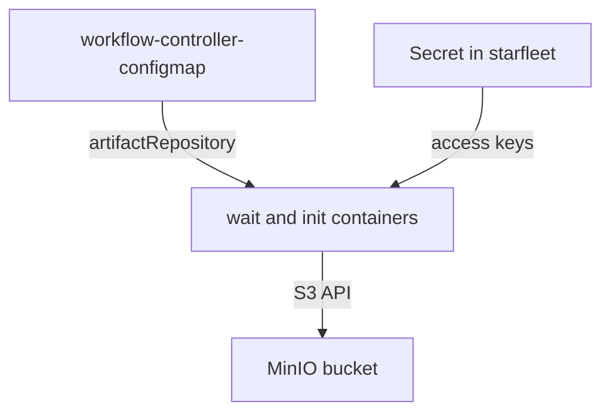

# The Artifact Repository

Every artifact needs a place to live. That place is the artifact repository, and the `wait` and `init` containers must find it and log in to it. This part explains where the repository is configured, what the configuration contains, and how a wrong setting shows up in a run.

## Supported repositories

Argo Workflows can store artifacts in several systems. The ones you should know by name are S3-compatible storage (Amazon S3 and MinIO), Google Cloud Storage, Azure Blob Storage, Artifactory, Alibaba Cloud OSS and HDFS. A workflow can also read inputs from a `git` repository, an `http` address or a `raw` string in the manifest. These three are input sources only.

The playground of this module uses MinIO, a small S3-compatible object store that runs in the `argo` namespace. From the workflow's point of view, MinIO behaves like S3, so the configuration uses the `s3` fields.

## The default repository

The default repository belongs to the whole installation. The administrator sets it in the ConfigMap `workflow-controller-configmap` in the namespace of the controller, under the key `artifactRepository`. The value is a YAML document stored as a string:

```yaml
artifactRepository: |
  s3:
    bucket: my-bucket
    endpoint: minio.argo.svc:9000
    insecure: true
    accessKeySecret:
      name: my-minio-cred
      key: accesskey
    secretKeySecret:
      name: my-minio-cred
      key: secretkey
```

The fields mean the following:

- `bucket` is the bucket that holds the objects.
- `endpoint` is the host and port of the storage service.
- `insecure: true` allows plain HTTP. Use it only for a local test store.
- `accessKeySecret` and `secretKeySecret` name a Kubernetes Secret and the key inside it. The Secret must exist in the namespace where the workflow runs, here `starfleet`, because the pod reads it.
- `keyFormat` (optional) sets how object keys are built. A key format can use tags such as `{{workflow.name}}` and `{{pod.name}}`.

The controller reads this ConfigMap, so a change applies to workflows that start after the change.

## A different repository for one workflow

A team can keep its artifacts in its own bucket. Two ways exist:

- Set `spec.artifactRepositoryRef` in the `Workflow`. It names a ConfigMap and a key inside it, in the namespace of the workflow. The ConfigMap value has the same shape as the default.
- Set the `s3` block on one artifact. Then the artifact names its own bucket, endpoint and secrets. This is useful when one input comes from a different store than the outputs.

A namespace can also hold a ConfigMap named `artifact-repositories`. It can mark one entry as the default for that namespace with an annotation, so every workflow in the namespace uses it without naming it.

## How a task finds credentials

The executor in the pod reads the Secret that the repository configuration names. The Secret must be in the same namespace as the pod. If the Secret or one of its keys is missing, the executor cannot log in, and the `init` or `wait` container reports the error.

Cloud installations often replace static keys with identity of the cluster (for example IAM roles for service accounts). The fields then differ, and the repository configuration states that the keys come from the environment.

## Failure examples

- The Secret does not exist in `starfleet`. The executor cannot read the access keys, so the upload or download fails and the node fails. The log of the `init` or `wait` container names the problem.
- The bucket does not exist. The upload fails and the `wait` container log shows the error from the storage service. The node fails.
- The endpoint is wrong. Uploads and downloads time out. The node fails after the timeout.
- Another tool deleted the object. A later step that uses `from` fails in the `init` container because the object cannot be downloaded.



The diagram shows the three inputs of an upload: the ConfigMap, the Secret and the storage service.

## Read the stored reference

After a run, the output artifact is recorded in the node status. The `s3.key` field holds the object key:

The commands in this part run against the module playground, with the kubeconfig of that playground selected.

<!-- astrona:playground:renew -->

```sh
kubectl -n starfleet get workflow <name> -o jsonpath='{range .status.nodes.*}{.outputs.artifacts}{"\n"}{end}'
```

The key is the proof that an upload happened. The reference alone does not prove that the object still exists later, because an administrator or a lifecycle rule can delete it.

## Retention belongs to the repository

Deleting a Workflow does not delete its artifacts unless artifact garbage collection is configured. Object stores usually offer lifecycle rules, which delete objects after a number of days. Decide who owns the cleanup before the repository fills up, and write the rule down next to the repository configuration.

## What you now know

The default repository is set in `workflow-controller-configmap`. A workflow can use another repository through `artifactRepositoryRef` or an inline `s3` block. The credential Secret must exist in the namespace of the workflow. A missing Secret, bucket or endpoint fails the node even when the container succeeds. The open question is how to see this on a live cluster, which the task and the practice session do next.

## Common pitfalls

> [!WARNING]
> The Secret with the access keys must be in the namespace where the pods run, not only in the `argo` namespace. A successful upload does not mean the object is kept: retention is set in the repository or by artifact garbage collection.
