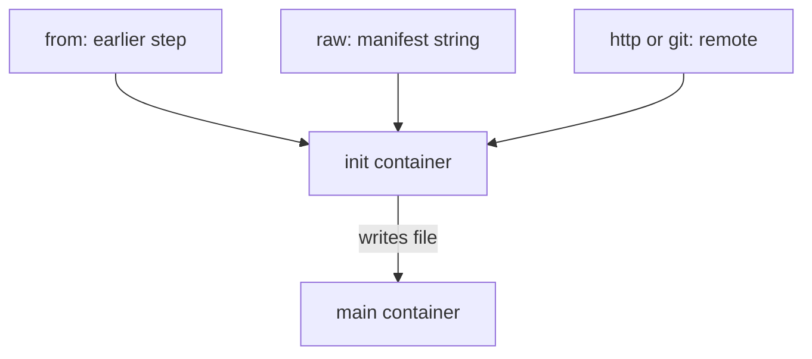

# Input Sources And Archive Options

An input artifact does not have to come from an earlier step. Argo can also fetch a file from a Git repository, from an HTTP address, from an object store, or take it from the manifest itself. The output side has options too: packing, permissions and optional files. This part lists the options, explains how the executor handles each one, and shows which choice fits which problem.

## Where an input artifact can come from

Inside `inputs.artifacts`, each entry names one source. The source type is a field of the entry. These types are the ones to know:

- `from` (set in the caller's `arguments.artifacts`) takes the reference of an output from an earlier step or task.
- `raw.data` holds a string in the manifest. Argo writes the string to the input path. It is useful for small fixed configuration and for tests, because no repository is needed.
- `http.url` downloads a file from an HTTP address. Headers and authentication can be added in the same block.
- `git.repo` clones a Git repository. The `revision` field selects a branch, tag or commit. The `depth` field makes a shallow clone.
- `s3` names a bucket and key in an S3-compatible store, so the input can come from a repository other than the default.

All of them put the data at the `path` of the input. The `init` container does the download, so a failure here stops the node before `main` starts.

## A raw input in a template

The manifest below is read as a fragment and is applied later in the practice session. The template takes a raw input, so it needs no external service:

```yaml
- name: show-note
  inputs:
    artifacts:
    - name: note
      path: /tmp/note
      raw:
        data: |
          roster: bridge, shuttle
  container:
    image: docker.io/library/python:3.13-alpine
    command: [python, -c]
    args: ["print(open('/tmp/note').read())"]
```

The `raw.data` value becomes the content of `/tmp/note`. A trailing line break belongs to the data, because the YAML block `|` keeps it. A test that compares the file with a string must account for it.

## Choosing a source

Use `from` when the data is produced in the same workflow. Use `http` for a public file that changes rarely, and pin a checksum or a version in the address, because the answer of a URL can change between runs. Use `git` when the input is code or configuration that has a history, and pin `revision` to a commit when a run must be reproducible. Use `s3` when a dataset lives in a bucket that is not the default repository.

A branch name such as `main` moves over time. Two runs started on different days can then read different data with the same manifest. A commit hash does not move.

## Packing outputs

When an output is a single file, the default tar and gzip packing hides the file inside a `.tgz` object. That is fine for passing data between Argo steps, because the next `init` container unpacks it. It is not fine when another program reads the object directly. Set `archive.none` to store the object as it is:

```yaml
outputs:
  artifacts:
  - name: staged
    path: /tmp/staged.txt
    archive:
      none: {}
```

With `none`, the object key should not end with a slash for a single file. For a directory, the key must end with a slash, and each file in the directory becomes its own object under that key prefix.

The `tar` option has a `compressionLevel` field. A value of `0` turns off compression and is useful for data that is already compressed, for example images, because compression costs time and gains nothing.

## Setting the key

An output can override the repository default with its own `s3.key`. The key can use tags that the controller replaces, for example `{{workflow.name}}/staged.txt`. Use a tag in the key when two runs write the same artifact name, because the same key would replace the earlier object. The workflow name is unique in a namespace, and `{{workflow.uid}}` is unique in the cluster.

## File mode

An input can set the file permissions with `mode`. The value is an octal number such as `0755`. Kubernetes stores the number in decimal, so `0755` appears as `493` when you read the object back. This matters when an input is a script that must be executable.

## Optional files

An output with `optional: true` does not fail the node when the file is missing. The step records no reference for it. A later step that uses `from` on a missing optional output must mark its own input `optional: true` too, or it fails when it tries to download a reference that does not exist.



The diagram shows that every source ends at the same place: a file at the input path that the `main` container reads.

## What you now know

An input artifact can come from a previous step, from the manifest, from HTTP, from Git or from another bucket. The output side can change packing with `archive`, set a key with `s3.key`, set file permissions with `mode` and tolerate a missing file with `optional`. The open question is what happens to stored objects after a run ends. The next part covers artifact garbage collection and log archiving.

## Common pitfalls

> [!WARNING]
> A moving Git branch or URL makes two runs read different data. A single file stored with `archive.none` needs a key without a trailing slash. A consumer of an optional output must also mark its input optional.
