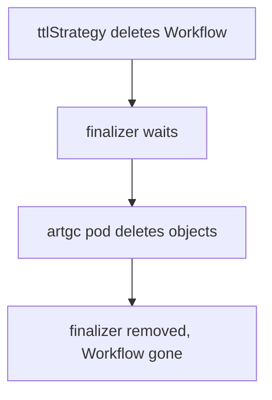

# Artifact Garbage Collection And Log Archiving

Deleting a Workflow object does not delete the files it uploaded. Over time, a repository fills with objects that nobody needs. Argo Workflows has a feature to clean them up, called artifact garbage collection. A second feature, log archiving, saves the container logs as artifacts so they survive after the pods are deleted. This part explains how both work and what each needs to work.

## What artifact garbage collection does

Artifact garbage collection (artifact GC) deletes the objects of a workflow's artifacts from the repository. You turn it on with a strategy. The strategy decides when the deletion happens:

- `OnWorkflowCompletion` deletes the artifacts when the workflow ends.
- `OnWorkflowDeletion` deletes the artifacts when the Workflow object is deleted.
- `Never` keeps the artifacts. It is the default.

The strategy can be set for the whole workflow in `spec.artifactGC.strategy`, or for one output in `outputs.artifacts[].artifactGC.strategy`. The artifact setting overrides the workflow setting. A common design deletes everything on workflow deletion but keeps the final report with `Never`.

```yaml
spec:
  artifactGC:
    strategy: OnWorkflowDeletion
    serviceAccountName: artifact-cleaner
  templates:
  - name: make-report
    outputs:
      artifacts:
      - name: report
        path: /tmp/report.txt
        artifactGC:
          strategy: Never
```

This fragment is for reading. It sets a workflow default and keeps one output.

## How the deletion runs

The controller does not call the object store itself. When the strategy applies, it creates a pod named like `<workflow>-artgc-<suffix>` in the namespace of the workflow. That pod runs the executor in a mode that deletes the objects. The pod uses the ServiceAccount named in `artifactGC.serviceAccountName`. Name it explicitly, and bind the Role below to it.

The controller adds a finalizer to a Workflow that uses artifact GC. A finalizer is a name in `metadata.finalizers` that stops Kubernetes from deleting the object until a controller removes the name. For artifact GC the finalizer name is `workflows.argoproj.io/artifact-gc`. When you delete the Workflow, it stays in `Terminating` state until the garbage collection pod finishes, and then the controller removes the finalizer.

## Permissions for the deletion pod

The ServiceAccount of the deletion pod needs a Role with these permissions in the workflow namespace:

- `list` and `watch` on `workflowartifactgctasks` in the API group `argoproj.io`.
- `patch` on `workflowartifactgctasks/status` in the same group.

The pod does not use the normal task result permission. A workflow that works fine for its tasks can still hang on deletion if this Role is missing. The Workflow then stays in `Terminating`, and a condition on the workflow reports the failure. The pod log of the `artgc` pod holds the error.

## Recover a stuck deletion

If the deletion pod cannot finish, two choices remain. Fix the permission or the repository access, and the controller retries until its retry window ends. Or set `spec.artifactGC.forceFinalizerRemoval: true`, which lets the controller remove the finalizer even when garbage collection failed. The second choice can leave objects behind in the repository, so use it only when you accept that.

## Archive container logs

Pod logs vanish when the pod is deleted. The setting `archiveLogs: true` saves the log of each container as an output artifact named `main-logs`. You can set it on a single template or on the whole workflow in `spec.archiveLogs`. The administrator can also turn it on for all workflows in the controller configuration.

The log artifact uses the same repository and the same credentials as other artifacts. It appears in `status.nodes[*].outputs.artifacts` like any other output, so a tool can find it by name. The web interface of the Argo Server shows these logs when the pod is gone.

Log archiving costs storage and upload time for every pod. It is common to turn it on for the failures that people must investigate later, together with a `podGC` strategy that removes the pods.

## Putting the settings together

A realistic retention policy for a batch pipeline has several parts that depend on each other:

- Pods are removed at the end with `podGC`, so the cluster stays clean.
- Logs are saved with `archiveLogs`, so failures can be investigated.
- The Workflow object is removed by `ttlStrategy` after some days.
- Artifacts are removed with `artifactGC.strategy: OnWorkflowDeletion`, so deleting the object also cleans the repository.

The artifact GC finalizer links the third and fourth item: when the TTL deletes the Workflow, the finalizer waits for the cleanup pod.



The diagram shows that the Workflow object stays until the garbage collection pod finishes.

## What you now know

Artifact GC deletes repository objects on workflow completion or deletion, with per-artifact overrides. A pod that uses its own ServiceAccount runs the deletion, and a finalizer blocks the Workflow deletion until it finishes. Logs are kept after pod deletion with `archiveLogs`. The next part is a practice session that stores and passes artifacts in the playground.

## Common pitfalls

> [!WARNING]
> A Workflow with artifact GC and no permission for `workflowartifactgctasks` can stay in `Terminating`. `forceFinalizerRemoval` frees the object but can leave files in the repository. Archived logs use the same repository and need storage space.
