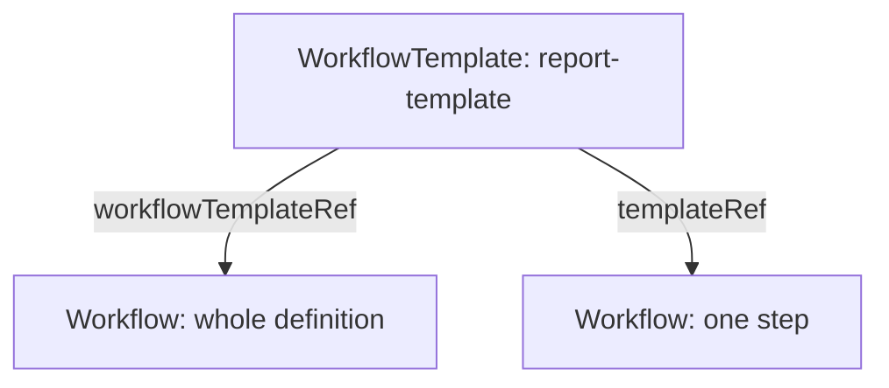

# WorkflowTemplate Definitions And References

Teams repeat the same pipeline many times with small differences: another input file, another environment. Copying the full `Workflow` each time makes the copies drift apart. Argo Workflows solves this with the `WorkflowTemplate`, a stored definition that many runs share. This part explains what a `WorkflowTemplate` holds, the two ways to reference it, and what happens to a run when the stored template changes.

## What a WorkflowTemplate is

A `WorkflowTemplate` is a Kubernetes object in one namespace. Its `spec` has the same shape as the `spec` of a `Workflow`: `entrypoint`, `arguments`, `templates` and the other fields. It has no `status` of a run, because it never runs by itself. Creating it only stores a definition.

```yaml
apiVersion: argoproj.io/v1alpha1
kind: WorkflowTemplate
metadata:
  name: report-template
  namespace: starfleet
spec:
  entrypoint: report
  arguments:
    parameters:
    - name: message
      value: draft
  templates:
  - name: report
    inputs:
      parameters:
      - name: message
    container:
      image: docker.io/library/python:3.13-alpine
      command: [python, -c]
      args: ["print('{{inputs.parameters.message}}')"]
```

This fragment is for reading. It defines one template and a default argument, and nothing starts.

## Reference the whole definition: workflowTemplateRef

A `Workflow` can use the stored definition with `spec.workflowTemplateRef`. The field names the `WorkflowTemplate`, and the `Workflow` adds only what is specific to the run:

```yaml
apiVersion: argoproj.io/v1alpha1
kind: Workflow
metadata:
  generateName: report-run-
  namespace: starfleet
spec:
  serviceAccountName: workflow-runner
  workflowTemplateRef:
    name: report-template
  arguments:
    parameters:
    - name: message
      value: approved
```

The `Workflow` has no `templates` and no `entrypoint`. It takes them from the referenced object. The `arguments` of the `Workflow` replace the default arguments of the template. The `serviceAccountName` also belongs to the run, so each run can use its own identity.

## Reference one template: templateRef

Sometimes a run needs only one template out of a library. The `templateRef` field inside a step or task selects a single template from a `WorkflowTemplate` by name:

```yaml
steps:
- - name: send-report
    templateRef:
      name: report-template
      template: report
    arguments:
      parameters:
      - name: message
        value: approved
```

The step runs the template `report` from `report-template`, but the rest of the calling workflow is its own. The calling workflow still needs its own `entrypoint` and its own `templates` list. In short, `workflowTemplateRef` reuses a whole workflow, and `templateRef` reuses one template inside another workflow.



The diagram shows the two ways a run can use the same stored object.

## What is copied into the run

When a `Workflow` uses `workflowTemplateRef`, the controller reads the `WorkflowTemplate` once, at the first reconcile of the run. It stores a copy of the spec in `status.storedWorkflowTemplateSpec` of the `Workflow`. After that, the run uses its own copy.

This has a useful consequence. If someone edits the `WorkflowTemplate` while the run is going, the running `Workflow` does not change. New runs use the new definition, and the finished run keeps the stored copy, so you can read later which definition it used.

A step that uses `templateRef` works differently. The controller reads the referenced template when it reaches that step. A change made to the `WorkflowTemplate` before that step runs can therefore reach a run that is already in progress.

## Submitting from a template

The `argo submit --from workflowtemplate/report-template` command creates a `Workflow` that already has the `workflowTemplateRef`. The `-p message=approved` flag adds the argument override. This is the usual way to start a run of a stored pipeline, and it does not need a file for the `Workflow`.

With `kubectl`, you write the small `Workflow` shown above and create it. Both ways produce the same object.

## Managing versions

A `WorkflowTemplate` has no built-in version field. Two methods help in practice:

- Include the version in the name, for example `report-template-v2`. Runs that need the old definition keep their reference.
- Keep the YAML in Git and apply it from a deployment tool, so every change has a history.

Labels help to find templates. The Argo Server and the `argo template list` command show the templates of a namespace.

## What you now know

A `WorkflowTemplate` stores a definition without running it. `workflowTemplateRef` reuses the whole definition and copies it into the run status at the start. `templateRef` reuses a single template and is read when the step starts. The open question is how a template can be shared across namespaces, which the next part covers with the cluster-scoped kind.

## Common pitfalls

> [!WARNING]
> A `Workflow` that uses `workflowTemplateRef` must not define its own `templates`. A `templateRef` step reads the template when it starts, so an edit can reach a run in progress. Changing a template does not change finished runs.
