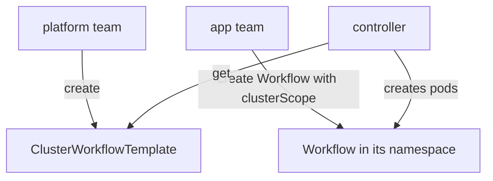

# ClusterWorkflowTemplate, Scope And Access

A `WorkflowTemplate` is visible only in its own namespace. A platform team that wants one standard pipeline for all teams would have to copy it into every namespace. The `ClusterWorkflowTemplate` removes the copies. This part explains how cluster scope works, how a run refers to it, and who may create or use it.

## A cluster-scoped kind

A `ClusterWorkflowTemplate` has the same `spec` as a `WorkflowTemplate`, but its `metadata` has no `namespace`. The API server stores one object for the whole cluster. Any namespace can use it.

```yaml
apiVersion: argoproj.io/v1alpha1
kind: ClusterWorkflowTemplate
metadata:
  name: standard-report
spec:
  entrypoint: report
  templates:
  - name: report
    container:
      image: docker.io/library/python:3.13-alpine
      command: [python, -c]
      args: ["print('standard report')"]
```

This fragment is for reading. It defines one template for the whole cluster.

## Reference it with clusterScope

A `Workflow` and a `templateRef` must say that the reference is cluster scoped. Without this flag, Argo looks for a `WorkflowTemplate` with that name in the namespace of the workflow, and the run fails with an error that the template was not found.

```yaml
spec:
  serviceAccountName: workflow-runner
  workflowTemplateRef:
    name: standard-report
    clusterScope: true
```

The same flag exists inside a step:

```yaml
steps:
- - name: report
    templateRef:
      name: standard-report
      template: report
      clusterScope: true
```

In both cases the object kind stays the same as before. Only the lookup changes: the name is resolved among the `ClusterWorkflowTemplate` objects.

## Who needs which permission

The controller reads the template. The ServiceAccount of the workflow pods does not read it, so the pods need no permission on templates. These permissions matter:

- A person who creates a `ClusterWorkflowTemplate` needs `create` on `clusterworkflowtemplates`. This is a cluster-wide right, so it belongs to platform administrators.
- A person who creates a `Workflow` that refers to it needs `create` on `workflows` in the namespace. Reading the template is done by the controller.
- The controller needs `get` and `list` on `clusterworkflowtemplates`. The standard installation grants this through its ClusterRole.

This split lets a platform team publish templates that application teams can run, without letting the application teams change them.

## Restricting what a run may use

The controller configuration can limit how a `Workflow` may be written. The `workflowRestrictions` block in the `workflow-controller-configmap` has the field `templateReferencing`. It accepts two values:

- `Strict` allows only `Workflow` objects that use `workflowTemplateRef`. A workflow with its own `templates` is rejected.
- `Secure` also requires `workflowTemplateRef`, and it also uses the stored copy of the template spec, so a change to the template during the run is ignored.

With `Strict`, application teams cannot start their own arbitrary containers through a workflow. They can only run the templates that the platform team has approved. Together with Kubernetes RBAC on `clusterworkflowtemplates`, this builds a controlled catalog.

## Choosing between the two kinds

Use a `WorkflowTemplate` when a definition belongs to one team and one namespace, and it can differ per namespace. Use a `ClusterWorkflowTemplate` when the same definition serves many namespaces and one owner updates it. Cluster scope means a change affects every namespace at the next run, so treat the kind like a shared library: version it by name, and test the change before you replace the object.

## Failure examples

- The `clusterScope: true` flag is missing. The run fails and the message says the namespaced template is not found.
- The name is correct, but the template is not in the cluster yet. The error is the same: not found. Check with `kubectl get clusterworkflowtemplates`.
- `Strict` is set and the `Workflow` has its own `templates` list. The API server or controller rejects the workflow because of the restriction.
- A person without `create` on `workflows` in the namespace tries to run the template. The request is denied by RBAC before any template lookup happens.



The diagram shows that the controller, not the application team, reads the cluster-scoped object.

## What you now know

A `ClusterWorkflowTemplate` is a cluster-wide definition, and a reference to it must set `clusterScope: true`. The controller reads it, so the workflow pods need no permission on templates. The `templateReferencing` restriction can force all runs to use approved templates. The next pages give a graded task for cluster scope and a practice session that exercises both kinds.

## Common pitfalls

> [!WARNING]
> Without `clusterScope: true`, the lookup uses the namespace and fails. A change to a cluster-scoped template reaches every namespace at the next run. `Strict` mode rejects a `Workflow` that defines its own `templates`.
