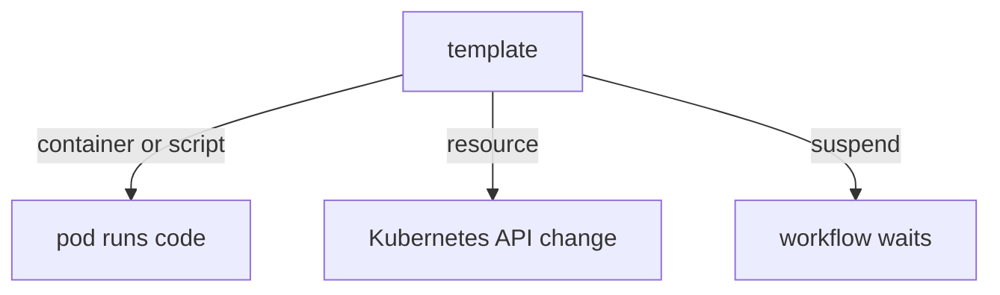

# Template Types

Every unit of work in an Argo workflow is a template, and a template has a type. The type decides what the controller creates: a pod, a Kubernetes object, a pause, or a group of other templates. Knowing the types lets you choose the lightest tool for a task and read any workflow quickly. This part covers the types that do work. The next part covers the types that combine them.

## The type is chosen by one field

A template has a `name` and exactly one of these type fields: `container`, `script`, `resource`, `suspend`, `containerSet`, `steps`, `dag`, `data` or `http`. If a template sets two of them, the controller rejects the workflow. The same template can also carry `inputs`, `outputs`, `retryStrategy`, `nodeSelector` and other settings that apply to any type.

## container

The `container` type runs one container in a pod. Its fields are the usual Kubernetes container fields: `image`, `command`, `args`, `env`, `resources` and `volumeMounts`. This is the most direct type, and the best choice when you already have an image with the tool you need.

```yaml
- name: build
  container:
    image: docker.io/library/python:3.13-alpine
    command: [python, -c]
    args: ["print('building')"]
```

The `command` replaces the entrypoint of the image, and `args` are its arguments. When you omit `command`, the image entrypoint runs and `args` are appended to it.

## script

The `script` type runs source code that you write in the manifest. It has the container fields plus a `source` field. The controller writes the source to a file in the container and runs the `command` with that file as its argument:

```yaml
- name: transform
  script:
    image: docker.io/library/python:3.13-alpine
    command: [python]
    source: |
      value = "{{inputs.parameters.item}}"
      print(value.upper())
```

The standard output of a `script` template is captured automatically. It becomes the output `result` of the node, which later templates can read as `{{steps.transform.outputs.result}}`. The value is limited to a small size, so a script should not print large data. With a `container` template, you must write a file and declare an output instead.

Use `script` for short logic that does not need its own image. Use `container` when the code is large or built into an image, because inline source is hard to test and to review.

## resource

The `resource` type applies an action to a Kubernetes object, without any pod running your code. The action is `create`, `apply`, `patch` or `delete`. The `manifest` field holds the object. The controller runs `kubectl` through the executor to do it:

```yaml
- name: make-config
  resource:
    action: create
    manifest: |
      apiVersion: v1
      kind: ConfigMap
      metadata:
        name: stage-config
      data:
        stage: one
    successCondition: metadata.name == stage-config
```

The fields `successCondition` and `failureCondition` let the node wait for a state of the created object, for example a Job that finishes. The ServiceAccount of the workflow pod needs RBAC permission for the action on that kind. Without it, the node fails with a forbidden error from the Kubernetes API.

## suspend

The `suspend` type pauses the workflow. With no `duration`, it waits until a person resumes it with `argo resume <name>` or until the node is resumed through the API. With a `duration`, it resumes after that time:

```yaml
- name: approval
  suspend: {}
```

A suspended workflow keeps phase `Running`. This type is used for manual approvals and for waiting between stages. No pod is created for the node.

## containerSet

The `containerSet` type runs several containers in one pod. The containers share the pod's volumes and can have dependencies on each other. It saves the cost of starting several pods, when the steps share a local volume. Its output handling uses a special container named `main`.

## data and http

The `http` type sends an HTTP request from the executor, without your own container. The `data` type reads a list of objects from an artifact store and filters them. Both are useful for small tasks, and both are less common in the exam than `container`, `script`, `resource` and `suspend`.

## Choosing a type

- Need a tool in an image and a command line: `container`.
- Need short inline code and its printed value: `script`.
- Need only to create or change a Kubernetes object: `resource`.
- Need a pause for a decision or a delay: `suspend`.
- Need to send one HTTP call: `http`.



The diagram shows that only some types create a pod that runs your code.

## What you now know

A template has one type field. `container` and `script` run code in a pod, `resource` changes a Kubernetes object, and `suspend` pauses a run. A `script` node exposes its standard output as `outputs.result`. The open question is how templates call each other, which the next part covers.

## Common pitfalls

> [!WARNING]
> A template can have only one type field. The `result` of a `script` template is limited in size. A `resource` template needs RBAC permission for its action on the target kind.
