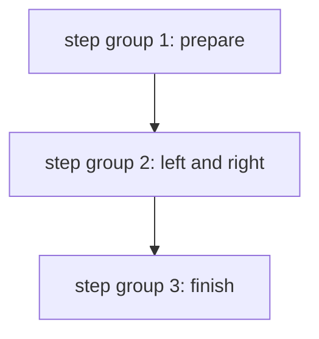

# Composing Templates With Steps And Parameters

Work templates do one thing. A real pipeline needs several of them in order, with data passed between them. Argo has two composition types for this: `steps` and `dag`. This part uses `steps` to show how one template calls another, how values move between them, and how a template can come from a `WorkflowTemplate` or be written inline. The `dag` type is covered later in the course.

## The steps template

A `steps` template holds a list of lists. The outer list runs in order. Each inner list is a group of steps that run at the same time:

```yaml
- name: pipeline
  steps:
  - - name: prepare
      template: prepare
  - - name: left
      template: work
    - name: right
      template: work
  - - name: finish
      template: finish
```

Here `prepare` runs first. `left` and `right` start together after it finishes. `finish` starts after both end. Each item has a `name` for the node and a `template` that names the template to call. The called template can be of any type, including another `steps` template.

If a step fails, the following outer groups do not start, and the workflow ends as `Failed`, unless the step sets `continueOn`.

## Passing values into a called template

A called template declares inputs. The step sets them with `arguments`:

```yaml
- - name: greet
    template: say
    arguments:
      parameters:
      - name: message
        value: '{{workflow.parameters.crew}}'
```

The value can be a fixed string, a workflow parameter or an output of an earlier step. The controller replaces the tags before the pod starts.

## Passing values out of a called template

A step reads the outputs of an earlier step with the tag `{{steps.<name>.outputs.parameters.<output>}}`. For a `script` template the standard output is `{{steps.<name>.outputs.result}}`. The next example passes the printed text of one step to the next:

```yaml
steps:
- - name: make
    template: make-value
- - name: use
    template: use-value
    arguments:
      parameters:
      - name: value
        value: '{{steps.make.outputs.result}}'
```

The tag works only for steps in an earlier outer group, because the controller needs the output before it can replace the tag. A tag that points to a step in the same inner group or a later group makes the workflow invalid.

## Outputs of a steps template

A `steps` template can expose an output of its inner steps, so the caller does not need to know the inner names. The `outputs.parameters[].valueFrom.parameter` field takes a tag:

```yaml
- name: pipeline
  outputs:
    parameters:
    - name: result
      valueFrom:
        parameter: '{{steps.finish.outputs.result}}'
  steps:
  - - name: finish
      template: finish
```

This makes `pipeline` look like a single template with one output. A larger workflow can then call `pipeline` as a black box.

## Templates from a WorkflowTemplate

A step can call a template that lives in a `WorkflowTemplate` with `templateRef`. The workflow does not need to contain the template:

```yaml
- - name: standard-check
    templateRef:
      name: shared-library
      template: check
```

Use this to share building blocks. The called template runs with the arguments you give. A change in the shared object reaches the next run that starts the step.

## Inline templates

A step can also define its template in place with `inline`. The template then has no name in the `templates` list and can be used only by that step:

```yaml
- - name: one-off
    inline:
      container:
        image: docker.io/library/python:3.13-alpine
        command: [python, -c]
        args: ["print('once')"]
```

Inline templates keep a small unique task next to its use. They cannot be reused, so move a task into a named template when two steps need it.

## When to choose steps

Choose `steps` when the order is simple and linear with a few groups of parallel work. The layout shows the order directly. When tasks form a graph with many dependencies, `dag` is clearer, because each task states what it depends on, and not the position in a list.



The diagram shows that groups run in order and steps inside a group run in parallel.

## What you now know

A `steps` template runs groups in order, with parallel steps inside a group. Step arguments pass values in, and the `steps.<name>.outputs` tags read values from earlier groups. A `steps` template can expose an output, call a template through `templateRef`, or define one with `inline`. The practice session on the next pages composes these pieces in the playground.

## Common pitfalls

> [!WARNING]
> A tag can read only from steps in an earlier group. Steps in one inner list run in parallel, so they cannot read each other. Inline templates cannot be reused, so move repeated tasks into named templates.
